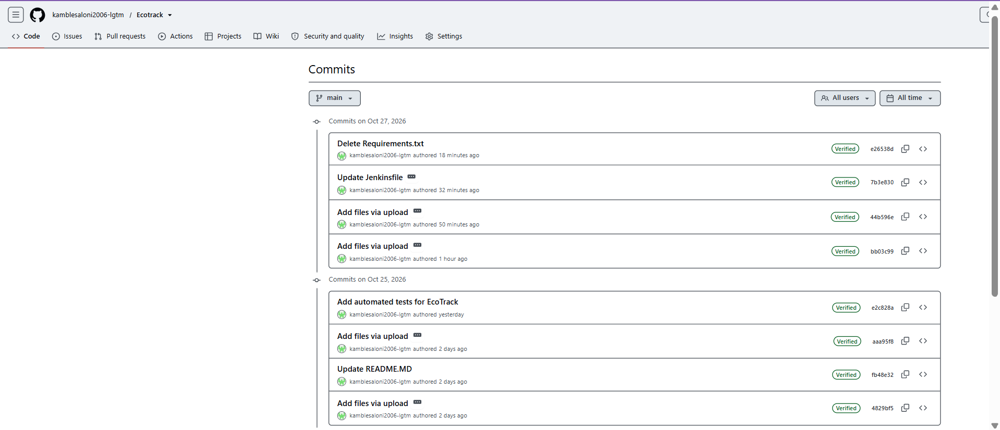
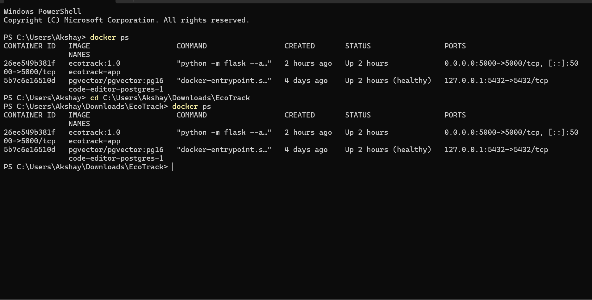
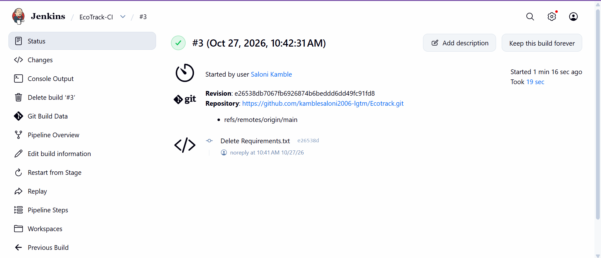

## Project Screenshots

### 1. GitHub Commit History

### 2. EcoTrack Web Application — Screenshot 1

### EcoTrack Web Application — Screenshot 2

### 3. Docker Container Running

### 4. Jenkins CI Pipeline Success

## DevOps Integration

- **Git and GitHub:** Version control and project change history.
- **Docker:** Containerized the EcoTrack Flask application.
- **Jenkins:** Automated dependency installation and application tests through a CI pipeline.
- **Automated Testing:** Verified application routes and waste-report submission using Python unit tests.
